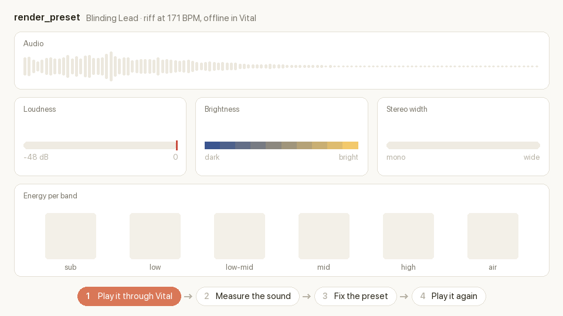

# vital-mcp

MCP server that lets AI assistants (any MCP client) design, edit and explain presets for
the free [Vital](https://vital.audio) wavetable synth.

[](https://www.youtube.com/shorts/i8LqMiOLWqg)

**Contents**
- **[Install](#install)**: [Claude Desktop](#claude-desktop-one-click) ·
  [Claude Code, Codex, VS Code](#agents-with-a-cli-one-command) ·
  [Cursor, Windsurf, Gemini CLI and others](#any-other-mcp-client-cursor-windsurf-gemini-cli-)
- **[Install with listening](#install-with-listening)**: let the model hear its presets
- [Tools](#tools) · [What you can set](#what-you-can-set)
- [Listening to presets](#listening-to-presets-optional): what it measures and how the model uses it
- [Where files go](#where-files-go) · [Limits](#limits) · [Development](#development)

## Listening to presets (optional)



An AI model can't hear, so on its own it designs presets blind. `render_preset` gives it ears:
it plays the preset through the real Vital plugin, saves a WAV you can listen to, and measures
the sound so the model can judge the result and fix it by itself. It runs offline and faster
than real time, with no DAW and no audio routing.

### Install with listening

Listening is optional because it installs [DawDreamer](https://github.com/DBraun/DawDreamer)
(about 130 MB) and needs Vital's VST3 installed. To turn it on:

- **Claude Desktop:** install
  [`vital-mcp-render.mcpb`](https://github.com/mard4/vital-mcp/releases/latest/download/vital-mcp-render.mcpb)
  instead of `vital-mcp.mcpb`.
- **Everything else:** use `"vital-mcp[render] @ git+https://github.com/mard4/vital-mcp"` as the
  `--from` value in the [install commands](#install) below. For example, in Claude Code:

  ```bash
  claude mcp add -s user vital -- uvx --from "vital-mcp[render] @ git+https://github.com/mard4/vital-mcp" vital-mcp
  ```

Without it, the other tools work as usual and `render_preset` explains how to enable it.

The plugin is found in the standard VST3 folders; override with `VITAL_PLUGIN_PATH`.
Renders go to a temp folder (`vital-mcp/renders`) unless you pass `out_path`.

## Install

You need Vital 1.5 or newer. For rendering (`render_preset`), Vital's VST3 must be installed too.

### Claude Desktop: one click

Download [`vital-mcp.mcpb`](https://github.com/mard4/vital-mcp/releases/latest/download/vital-mcp.mcpb)
from the latest release and double-click it (or drag it into Claude Desktop's
Settings > Extensions), then click **Install**. Claude Desktop sets up Python and the
dependencies itself. The Vital folder setting is optional.

To also listen to presets, install
[`vital-mcp-render.mcpb`](https://github.com/mard4/vital-mcp/releases/latest/download/vital-mcp-render.mcpb)
instead (see [Listening to presets](#listening-to-presets-optional)). Install only one
of the two.

### Agents with a CLI: one command

These need [uv](https://docs.astral.sh/uv/). `uvx` downloads and runs the server
straight from GitHub

**Claude Code**
```bash
claude mcp add -s user vital -- uvx --from "git+https://github.com/mard4/vital-mcp" vital-mcp
```

**Codex**
```bash
codex mcp add vital -- uvx --from "git+https://github.com/mard4/vital-mcp" vital-mcp
```

**VS Code (Copilot agent mode)**
```bash
code --add-mcp '{"name":"vital","command":"uvx","args":["--from","git+https://github.com/mard4/vital-mcp","vital-mcp"]}'
```

### Any other MCP client (Cursor, Windsurf, Gemini CLI, ...)

Add this to the client's MCP config (`~/.cursor/mcp.json`, `~/.gemini/settings.json`, ...):

```json
{
  "mcpServers": {
    "vital": {
      "command": "uvx",
      "args": ["--from", "git+https://github.com/mard4/vital-mcp", "vital-mcp"]
    }
  }
}
```

To pick up a new version, run this once:

```bash
uvx --refresh --from "git+https://github.com/mard4/vital-mcp" vital-mcp
```

For development, clone the repo and point the client at your checkout:
`"command": "uv", "args": ["--directory", "/path/to/vital-mcp", "run", "vital-mcp"]`.

## Where files go

- Presets are read from Vital's data folder (from `Vital.config`, usually `~/Music/Vital`
  on macOS and `Documents/Vital` on Windows). Override with `VITAL_DATA_DIR`.
- New presets are saved to `User/Presets/MCP/`. Open them from Vital's preset browser.
  After an edit, reselect the preset in Vital to reload it.
- Overwritten presets are backed up to `User/.vital-mcp-backups/`.

## Limits

- This writes files. It doesn't control a running Vital instance, so there's no live
  knob-turning. Pair it with a DAW MCP (for example an Ableton MCP) for that.
- Samples (the SMP oscillator) and the wavetable editor's file and line sources are kept
  as they are but can't be generated.

# Details
## Tools

| Tool | What it does |
|---|---|
| `list_presets` | Search the presets in your Vital folder |
| `describe_preset` | Readable breakdown: oscillators, wavetables, filters, envelopes, LFOs, mod matrix, macros, FX |
| `get_preset_parameters` | Exact values in display units (Hz, ms, dB, %) |
| `list_parameters` | Look up parameter names, ranges, defaults and menu options |
| `create_preset` | Build a preset from the init patch or an existing preset |
| `edit_preset` | Change parameters, modulations, wavetables or LFO shapes, in place (with backup) or as a copy |
| `compare_presets` | Diff two presets |
| `render_preset` | Play a preset through the real Vital plugin offline, save a WAV and describe the sound (optional, see below) |

### What you can set
- **All ~800 parameters** in friendly units: `"filter_1_cutoff": "1.2 kHz"`, `"env_1_release": "800 ms"`,
  `"reverb_dry_wet": "25%"`, `"filter_1_model": "Ladder"`, `"lfo_1_tempo": "1/8"`.
- **Modulation matrix**: `{"source": "lfo_1", "destination": "filter_1_cutoff", "amount": 0.35}`.
- **Wavetables**: basic shapes, additive harmonics, mixes, drive/fold, and morphing tables
  (`{"morph": ["saw", {"shape": "square", "drive": 3}], "steps": 8}`).
- **LFO shapes**: sine, triangle, saw, square, ramps or custom points with curve powers.
- **Metadata**: name, style, author, comments, macro labels.

Values outside a parameter's range are clamped and reported, and typos get suggestions.

**What it measures**

| Reading | What it tells the model |
|---|---|
| Peak and RMS level, clipping | Is it too loud, is it distorting, is there headroom left for mixing? |
| Spectral centroid and rolloff | How bright or dark it sounds |
| Energy per band (sub, low, low-mid, mid, high, air) | Where the sound sits: boomy, muddy, thin or harsh |
| Stereo correlation and side/mid ratio | Mono, wide, or so wide it falls apart in mono |
| Attack, sustain level, tail length | Plucky or soft, sustained or short, how long the delay and reverb ring |

**The loop: create, listen, fix, listen again.** In the demo at the top, the first render of
the Blinding Lights lead came back at 999 Hz with peaks at -1.5 dB: dull and close to clipping.
Claude opened the filter from 2.2 to 4.5 kHz and lowered the volume by 3 dB, and the second
render read 1213 Hz and -7.5 dB.

You don't need to ask for numbers. Plain requests work: *"listen to it and fix anything that
sounds off"*, *"make it brighter and check it"*, *"does it clip?"*.

**Options**
- `notes`: what gets played. A pattern (`riff`, `note`, `chord`, `bass`, `pluck`) or your own
  notes, plus `bpm`, `transpose` and `tail` (seconds rendered after the last note, for release,
  delay and reverb).
- `reference`: a WAV of a sound you want to match. The reply compares tonal balance and levels
  against it.

## License

GPL-3.0-or-later. `vital_mcp/schema.json` is derived from Vital's GPL-3.0 source
(github.com/mtytel/vital). Not affiliated with or endorsed by Vital Audio.
